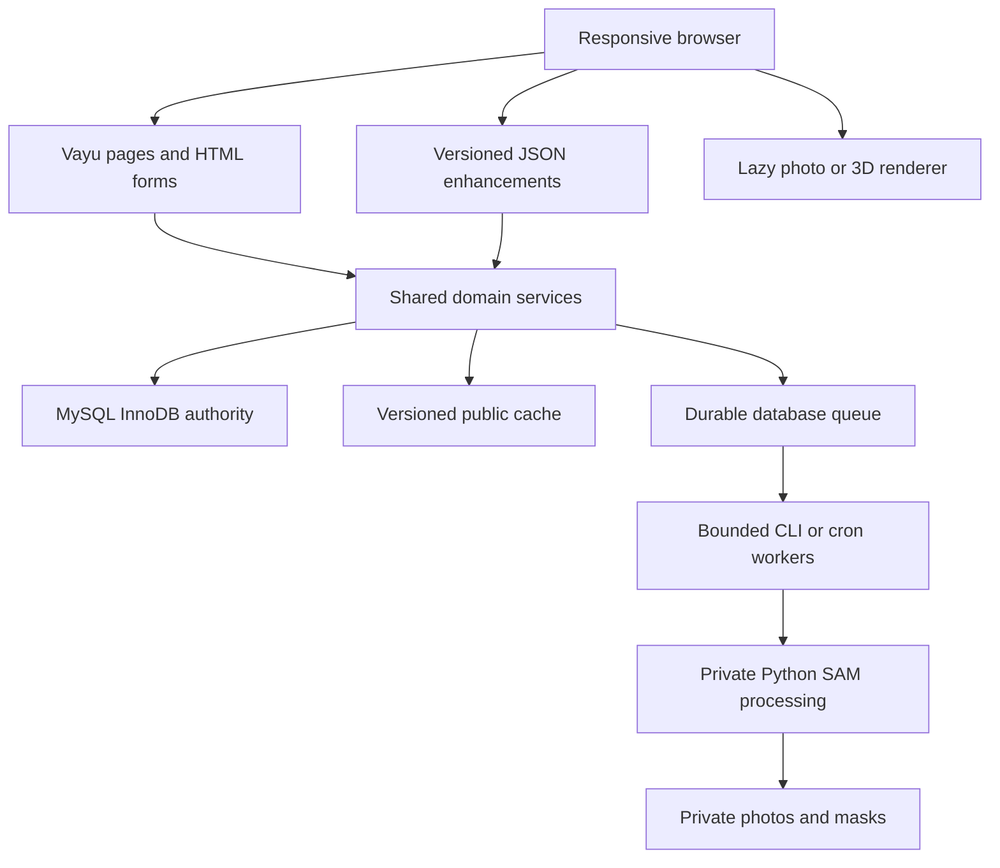

# Website feature parity and integration plan

Prepared 2026-10-11. Planning delivery `PAR-PLAN-01`; proposed implementation
slices below are not implementation claims. This plan extends the
[commerce plan](commerce/implementation-plan.md),
[contracts](commerce/contracts.md), and
[SAM plan](room-visualizer-sam2-plan.md). Existing task status stays in the
[tracker](commerce/tracking.md). The original request authorized planning.
The subsequent 2026-10-11 request, “okay implement step by step,” authorizes
sequential local implementation. Production changes, publishing and Flutter
API integration remain outside that authorization.

## 1. Outcome and boundaries

One responsive Vayu website should contain the useful sections currently found
in the offline Flutter app, reuse the HTML visual design, and use server-owned
commerce data. Keep `Website/` as the deployable source. `Html/` remains a design
reference/test fixture; do not maintain two separate production storefronts.
Flutter remains offline until its own API integration milestone is authorized.

Parity means matching useful behavior, rather than copying demo claims, payment
simulation, seeded orders, fake delivery rules, or every mobile navigation pattern.
Publish content/stats/delivery promises only with operator-approved information.
Preserve Developer authentication and routes, template notices and local assets.

## 2. Current sources and first integration gate

Existing sources inspected:

- `Html/storefront.js`: homepage/catalog/product/cart/calculator and legacy saves;
  `visualizer-editor.js`, `visualizer-renderer.js`: local photo editor and IndexedDB.
- `Mobile/lib/features/`: home/product/discovery/reviews, catalog/search, accounts,
  checkout/orders/support and visualization; `core/routing/routes.dart` is the
  screen inventory. Flutter payment/auth are explicitly prototype/offline flows.
- `Website/app/view.php`, `api/gateway.php`, `config/classes.php`: registrations.
- `app/Services/`: catalog/cache, products, cart/address, inventory/orders, queue;
  `core/Auth.php`, `CommerceAccess.php`, `RequestSecurity.php`, `PrivateStorage.php`.
- `app/bridge/Cart.php`, existing PHP storefront views, queue registry and worker.

Do not infer end-to-end correctness from tracker labels. Source inspection found
the Cart controller referencing `CommerceTest\\CartService`, calling namespaced
services inconsistent with the class map, generating a new checkout key per call,
and no explicit POST route mapping `placeOrder` in `app/view.php`. Existing
OrderService cancellation also needs a dedicated ownership/state/stock audit.
These are source findings, not results of new runtime tests. Reconcile them in
PAR-00 before adding checkout UI or declaring existing tasks integrated.

## 3. Architecture and ownership



- PHP renders catalog/product/account/order content; JavaScript enhances filters,
  cart controls and interactive tools. HTML controllers call services directly.
- Shared templates own header, search, account links, footer, cards, money/unit
  display, alerts, pagination and accessible dialogs. Add route/class registrations
  deliberately; render full `app/page/...php` paths.
- Product variants, prices, units, inventory and order totals come from MySQL.
  Money uses integer minor units and quantity uses milli-units. Browser estimates
  and Flutter doubles never become accepted checkout totals.
- Public catalog caching uses durable catalog versions and canonical bounded keys.
  Checkout revalidates DB prices/stock. Private account/cart/order responses are
  no-store and cannot enter shared page caches.
- New services/migrations are added only when a delivery slice needs real behavior.
  Keep sequential migration order, explicit SQLite/MySQL differences, and no
  required Redis or daemon.

Proposed presentation organization inside Website (paths to be created during
implementation, not existing files):

```text
app/page/layouts/storefront.php
app/page/partials/{header,footer,product_card,pagination,feedback}.php
app/page/storefront/{home,product_listing,product_detail,search}.php
app/page/account/        profile, addresses, wishlist, notifications, designs
app/page/checkout/       cart, checkout, payment status, confirmation
app/page/orders/         history, detail, tracking, return request
app/page/support/        help, about, sample request, project quote
app/page/tools/          calculator, visualizer
app/page/catalogues/     library, reader
public/assets/storefront/  shared styles, page modules, licensed local assets
```

Adapt existing views rather than blindly creating duplicate files/controllers.
Resolve actual public asset URL conventions in PAR-01 before moving files.

## 4. Delivery sequence

Implementation slices are proposed IDs with the dependencies below. At execution,
claim each selected slice and map its evidence into existing task IDs; do not
mark the entire original commerce backlog done from a parity slice.

| Slice | Dependencies | Deliverable | Existing task alignment | Acceptance |
| --- | --- | --- | --- | --- |
| PAR-00 | Existing source | Audit/reconcile route, loader, principal, service signatures, checkout keys, order transitions and migration state | FND/IAM/ORD, WEB-02 | Real local HTTP shopping flow and disposable MySQL ownership/idempotency/stock tests; Developer preserved |
| PAR-01 | PAR-00 | Shared storefront shell and local assets; transfer HTML home/list/detail/catalogue designs into Vayu | WEB-01, ADM-01 asset policy | Direct URLs render useful HTML without JS; responsive/accessibility/error states; no CDN requirement |
| PAR-02 | PAR-01 | Full filters/search, variant selection, gallery, live quantity estimate, delivery policy UI, sticky purchase controls; multi-surface calculator and four-product comparison | WEB-01/03 | Bounded queries, correct units, validated filter URLs, calculator handoff and comparison on mobile |
| PAR-03 | PAR-00/01 | Login/register/verification, profile, addresses, guest cart merge, owned wishlist; account dashboard | WEB-02/03, IAM, OPT-01 wishlist sub-slice | CSRF/session/ownership and account-switch isolation; recoverable validation; guest merge replay safe |
| PAR-04 | PAR-02/03 | Real cart, server quote, checkout, confirmation, owned order list/detail/tracking; customer cancellation, reorder, returns and invoice access where supported | WEB-02/03, ORD-01/02, ADM-03 | Checkout retries/stale-cart/last-stock/cancellation races pass on MySQL; snapshots match UI |
| PAR-05 | PAR-02/03/04 | All reviews/write-review, moderation, ratings, coupons/redemptions, product pairings, homepage history/discovery sections | OPT-01, EVT/SRCH/REC for advanced ranking | Approval/redemption ownership, last-coupon race, trusted rating aggregates; no fabricated personal history |
| PAR-06 | PAR-01/03 | Help/About, sample/quote requests, notifications and read state, appearance controls; supporting staff workflows | ADM-03, bounded new support task guides | Requests persist and staff can process them; private notifications and authorized read-state updates |
| PAR-07 | PAR-01/02/03; SAM-01/02 | Integrate photo editor and saved designs, private uploads/AI jobs, then furnished 3D presets and mode parity | SAM-03–06 and existing room plan | Safe uploads, quotas, revision/lease fencing, export/save fidelity; device/asset proof for 3D |
| PAR-08 | Completed slices | Consolidated parity, operations, performance, migration/recovery and release review | OPS-01/02 | Measured budgets, actual MySQL concurrency and host capability evidence; explicit publishing authorization |

PAR-06 and photo-preset integration can proceed while advanced recommendations
or provider setup are pending. Delivery is sequential by default; no delegation
or parallel agents have been requested for this implementation session.

## 5. Complete parity checklist

### Home and discovery

Keep hero/deals, categories, featured materials, best sellers, catalogues and tool
shortcuts. Add separate Trending Now, shoppable Get the Look, coupon offers,
Recently Viewed, Buy Again, Inspired by Purchases, and sample/quote support.
Recent products/searches may stay bounded and local for guests, with clear-history
controls. Purchase history always comes from owned completed orders. Hide empty
personal sections; show curated/same-category fallbacks with accurate labels.
Use simple curated/category/color/finish matching first. Co-purchase ranking and
popular/trending counts need trusted events/aggregates and existing REC/SRCH gates.

### Catalog, search and product detail

Add origin/brand/minimum-rating/in-stock filters alongside category/color/finish/
price; bounded facets and deterministic sorting; recent/popular search suggestions.
Implement gallery, availability, product-specific catalogue link, quantity estimate,
calculator handoff, delivery checker, application/specification content, full rating
distribution and review links. Add distinct You Might Also Like, Similar Products,
Better Together with combined estimate/add, and Shop by Brands.

Pair addition should validate both variants/quantities and update one owned cart
transactionally or explain unavailable items before mutation. Buy Now uses an
explicit checkout scope so unrelated cart lines are not accidentally purchased.
Sticky controls remain keyboard accessible and cannot cover content on phones.
Delivery rules use configured service regions/rates; never port even/odd PIN logic.

### Account, cart, checkout and orders

Account/profile, login/registration/email verification, owned address CRUD,
wishlist, coupon list/application, cart move-to-wishlist, detailed server totals,
checkout and confirmation. Prevent empty carts, address switching, stale revisions
and double submission from bypassing validation. Bind the checkout key to semantic
inputs and preserve it across timeouts/retries. Reorder builds a new cart at current
prices/availability; it never reuses an old paid order or silently submits checkout.

Add order history/detail and timeline from actual transitions, customer cancellation
where legal, return/replacement request workflow and authorized invoice access.
Define fulfillment/status/return policies and staff processing before exposing
actions. Return requests do not automatically restock or refund. Invoice/tax
documents require configured business/tax details, durable numbering and immutable
financial data; otherwise expose an order summary with an accurate label.

### Reviews, promotions and support

Full reviews list, sorting, star breakdown, write-review, verified-purchase policy
and staff moderation. Aggregate approved reviews only. Server validates coupon
dates, eligibility, caps and integer discounts and records redemption with order
commit; retries cannot spend a coupon twice. Update the shared lock contract before
extending checkout locking for coupons. Cancellation redemption policy is explicit.

Dedicated sample form (up to three eligible materials), project quote form with
type/timeline/requirements, Help/FAQs/About, notification list/read state and
theme/accent settings. Persist requests and expose staff processing/status. Notification
inbox records are separate from external email delivery attempts. Theme can persist
locally for guests and per user when signed in, with contrast/accessibility checks.

### Calculator, comparison, catalogues and visualization

Calculator supports named, independently measured surfaces, units, cut-outs,
wastage, slab/box increments, optional charges, quantity handoff and server-confirmed
shopping totals. Comparison supports four products with responsive/accessible table
navigation. Catalogues reuse licensed local PDFs, lazy-load readers and link from
matching products/brands; downloadable PDFs are not fetched with every product.

Retain photo surfaces, brushes, perspective, rotation/grout/shading, original toggle
and image export. Introduce versioned, owned server saved designs while retaining
guest-local designs. Cloud import is explicit and idempotent, validates product/
variant mappings, and handles missing/archived products. Never silently upload a
guest's private photos on login. Do not upload demo carts, orders or credentials.

For 3D, first prove one furnished licensed GLB with independent floor/wall/counter
meshes, texture scale, camera controls and capture. Keep photo and 3D settings in
one versioned design state with stable surface bindings. An uploaded photo remains
2D; SAM segmentation does not reconstruct 3D or supply room measurements. Expand
room assets only after the first device benchmark. Do not put 3D code/models in
catalog or checkout bundles.

## 6. Data, migration and APIs

Reuse users/grants, catalog/variants/images, inventory, carts/addresses, orders/
snapshots/history, cache versions and durable jobs. Add only needed schema for
profiles, wishlists, moderated reviews/aggregates, coupons/redemptions, support
requests, returns, notification inbox/read status, licensed catalogue/room metadata
and private visualizer assets/requests/designs. Use positive IDs, UTC timestamps,
owner/status/revision indexes and immutable order snapshots. Plan fresh/upgrade/
rerun checks and forward repair for MySQL DDL before each migration slice.

HTML forms and APIs share validation/guards/services. Extend `/api/v1` with catalog
facets/search, auth/verification, cart/quote, addresses, orders/actions, wishlist,
reviews, coupons, support requests, notifications and visualizer resources as each
slice is implemented. Define body limits, pagination, revision/idempotency rules
and safe errors before exposing an endpoint. No cross-origin cookie access by
default. Server derives ownership, prices, payment state and grants.

Keep the existing HTML demo products separate from production data. Any initial
catalog import needs a reviewed SKU/variant/unit/texture mapping and licensed
assets, not a silent import of `storefront-data.js`. Local wishlist/cart import must
resolve those mappings, reprice against DB, respect guest-merge ownership and give
the customer a clear conflict report. Never carry demo prices/reviews/stock into
production as verified facts.

## 7. Optimization plan and proposed budgets

These are acceptance targets to measure, not current performance claims. Use a
documented mid-range phone, throttled connection and warmed/cold server runs.

| Area | Approach | Initial target / evidence |
| --- | --- | --- |
| Initial pages | Server HTML, shared CSS, page-specific deferred JS | LCP <=2.5 s, CLS <=0.1, interaction latency <=200 ms in reference runs; report distribution and conditions |
| Public requests | Prepared/indexed queries, bulk joins, bounded facets and versioned cache | p95 server response <=500 ms on agreed representative load; no per-card query growth |
| JavaScript | No SPA rewrite; lazy tool/editor/3D modules | Ordinary shopping pages <=150 KiB compressed initial JS, excluding on-demand tools |
| Images | Responsive sizes, WebP where suitable, dimensions, eager hero/lazy lower cards | Product thumbnails do not download full slabs; offscreen galleries/models/PDFs remain unfetched |
| Discovery | Bounded home rails, bulk product loads, precomputed advanced ranks | No per-user full-catalog scan or synchronous analytics rebuild per page |
| AI | Encode photo once per request batch, cached private embeddings where validated, bounded concurrency | Benchmark cold/warm p50/p95, RSS, failure rate and queue delay; calibrate worker budget/lease from measurements |
| Browser renderer | Reuse decoded textures, cap photo resolution, render on changes and dispose unused resources | Reference device keeps editor responsive; record memory/frame/export results before setting final limits |
| 3D | Lazy asset load, optimized meshes/textures, inactive viewport paused | First-room proof targets sustained 30 fps and a measured download/memory budget; no blanket device guarantee |
| Persistence | Bounded recent-history lists, paginated orders/reviews/notifications; private media expiry | No unbounded JSON/localStorage image blobs or unbounded account queries |

Never cache a private checkout page as an optimization, remove money locks to
improve speed, or infer MySQL correctness from SQLite tests. External eviction
runs after commit; durable versions advance with writes.

SAM feasibility measured roughly 927 MiB peak RSS and ~10 seconds process wall
time in one local small-model run. Do not execute inference in a PHP web request.
Use private CLI/cron batches and per-owner quotas, cancellation/revision fencing,
lease-token acknowledgment, bounded retry and manual-edit fallback. Hosting needs
verified Python/PyTorch/memory/runtime support or a separately secured processing
machine. Cross-machine job transport requires an explicit authentication/asset/
ownership design; do not expose a public unauthenticated Python endpoint.

## 8. Operational and provider gates

The staff console must support the customer promises: product/stock changes,
fulfillment transitions, coupon policy, review moderation, returns, support requests
and catalogue/room assets, with exact grants/audit. Do not expose customer actions
with no durable staff workflow. A bounded queue backs verification/notifications
and AI; queued is not delivered. Private cleanup and queue metrics are required.

Actual payment provider onboarding, credentials, signed webhooks, reconciliation
and refund/stock policies remain OPT-04 gates. Plan full method/status UI now;
enable only configured methods. No fake success, production simulation, or assumed
UPI/card/EMI availability. COD itself needs operator policy configuration. Courier
tracking/WhatsApp/external mail similarly require authorized provider setup.

Production host checks, external accounts, deployment and migrations require their
respective explicit authorization and capability evidence. Work on `main` only;
sync scripts are publishing operations, not verification commands.

## 9. Definition of done per slice

1. Real routes, shared services and persistence; desktop/mobile, keyboard,
   loading/empty/error/offline states and direct URL navigation work.
2. Authentication/ownership/CSRF, safe uploads, account-switch isolation and
   private cache/media access checks pass where applicable.
3. Migration compatibility and actual supported MySQL concurrency checks pass
   for money/stock/coupon/lease changes; SQLite is additional local coverage.
4. Relevant browser flows and Developer regression pass; record command outputs,
   environment versions, measured budgets and unresolved checks in the tracker.
5. Every parity row maps to a delivered route/section and evidence, or a specific
   provider/capability blocker. A displayed placeholder is not feature completion.

First implementation slice: PAR-00 audit and repair. Then PAR-01 should make the
existing design the real PHP storefront before adding the missing feature pages.
